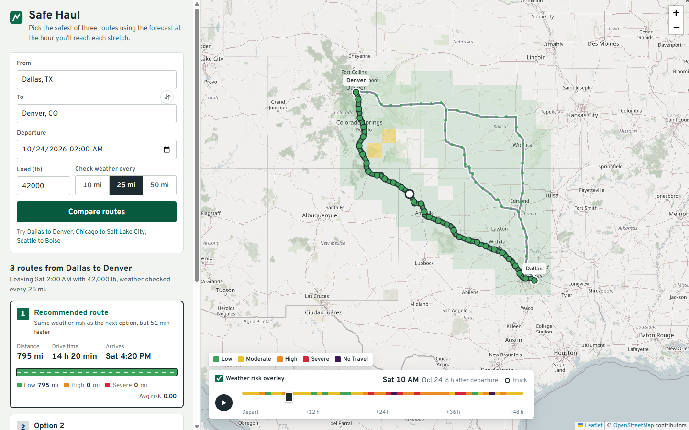

# Safe Haul: weather-aware truck routing

A React + Django app that helps a truck driver pick the safest of three routes, using **forecast weather at the hour the truck reaches each stretch**, the **load weight**, and **travel time**.

- **Live app:** _add your Vercel URL here_
- **API:** _add your Render URL here_ (free tier sleeps: the first request after idle can take ~30–50 s)
- **Walkthrough:** _add your Loom link here_



## What it does

1. You enter an origin, destination, departure time, load weight, and a checkpoint interval (10 / 25 / 50 mi).
2. The backend fetches **3 route options**, places a **checkpoint every N miles** on each, works out the **ETA** at every checkpoint, and reads the **hourly forecast for that exact hour** (wind, gusts, rain, snow).
3. Each checkpoint gets a **risk level** from the rule table + load rules. Routes are summarised (miles per risk level, average risk) and **ranked** with a plain-language reason.
4. The map shows all routes, checkpoints coloured by risk (popups with ETA, wind/gust, rain, snow, level, drivers, load rule), and a **corridor weather heatmap with a 0–48 h slider**.

## Running locally

Requirements: Python 3.12+ and Node 20+.

```bash
# Backend (http://localhost:8000)
cd backend
python -m venv .venv
.venv/Scripts/activate        # Windows  (macOS/Linux: source .venv/bin/activate)
pip install -r requirements.txt
cp .env.example .env          # no API keys needed
python manage.py migrate
python manage.py runserver

# Frontend (http://localhost:5173)
cd frontend
npm install
cp .env.example .env          # VITE_API_URL=http://localhost:8000
npm run dev
```

Tests: `cd backend && python manage.py test` (55 tests, no network: all external APIs are mocked). Frontend: `npm run build` (type-checks, then builds).

A Postman collection is in [`postman_collection.json`](postman_collection.json).

## APIs used and call counts

All free, no API keys:

| Purpose | Service | Why |
|---|---|---|
| Routes | **OSRM** public server (`alternatives=3`, per-segment durations) | Keyless and returns alternatives for long US trips. OpenRouteService only allows alternatives on short routes (~100 km). |
| Geocoding | **Nominatim** (`countrycodes=us`) | Free and good with "City, ST". Results cached for 7 days. |
| Weather | **Open-Meteo** hourly forecast | Free, keyless, takes **many coordinates in one request**, and returns `wind_speed_10m`, `wind_gusts_10m`, `rain`, `showers`, `snowfall` with `wind_speed_unit=mph&precipitation_unit=inch`. The response's `hourly_units` confirms snowfall comes back in **inches** with these settings. The code still converts if it ever reports cm. |
| Base map | **OpenStreetMap** standard tiles via Leaflet | Free and keyless. Desaturated with a CSS filter so the risk colours stand out. |

External calls for one analysis:

- **0–2** geocode calls (none for `lat,lon` input or cached names)
- **1** OSRM call. If OSRM returns fewer than 3 distinct routes, up to **4** via-waypoint calls run **in parallel** (see below)
- **1–4** Open-Meteo calls for *all* checkpoints of *all* routes together (100 locations per request, parallel)
- Heatmap (separate request, loaded right after): **1–3** Open-Meteo calls

Everything is cached: geocodes (7 days), routes (6 h), weather per location and hour window (45 min), full analysis (30 min). A repeated analysis returns in milliseconds.

### Getting three routes

OSRM often returns only 1–2 alternatives. In that case the backend asks for routes through a **via-point offset sideways from the midpoint** (±12% and ±22% of the straight-line distance) and keeps a candidate only if:

- it is not a near-copy of an existing route (≥85% of points within 3 mi of each other, checked both ways), and
- it takes no more than 1.6× the fastest route's time.

The UI shows which routes are alternatives and says so if fewer than 3 distinct roads exist.

## Risk rules (how the table is interpreted)

The brief's table uses overlapping integer ranges (e.g. wind "25–34", "35–44"). Forecast values are decimals, so the rules use **continuous, half-open ranges**:

| Condition | Low | Moderate | High | Severe | No Travel |
|---|---|---|---|---|---|
| Wind (mph) | < 25 | 25 to < 35 | 35 to < 45 | 45 to < 55 | ≥ 55 |
| Rain (in/hr) | < 0.10 | 0.10 to < 0.25 | 0.25 to < 0.50 | 0.50 to 1.00 | > 1.00 |
| Snow (in/hr) | < 0.5 | 0.5 to < 1.0 | 1.0 to < 2.0 | 2.0 to 3.0 | > 3.0 |

**Load rules** (they can only raise the wind level):

- wind ≥ 55 mph → **No Travel** for any load
- 45 ≤ wind < 55 and load **> 30,000 lb** → **No Travel**
- 35 ≤ wind < 45 and load **> 40,000 lb** → **Severe**

A checkpoint's level is the **worst** of wind (after load rules), rain and snow. The response lists which condition(s) drove it and which load rule fired.

- **Wind = sustained 10 m wind speed.** Gusts are shown alongside but not used, because the thresholds read like sustained-wind limits. Switching to gusts is a one-line change (`WIND_SOURCE` in `risk.py`).
- **Rain = `rain + showers`** (liquid only). `precipitation` would double-count snow.
- Scores for averaging: Low 0, Moderate 1, High 2, Severe 3, No Travel 4.

All rules live in one pure module, `backend/routing/services/risk.py`, tested at every boundary, plus a vectorised version for the heatmap that is tested to agree with it on random inputs.

## Recommendation

Each checkpoint stands for the road **halfway to its neighbours** (the first and last only the inside half), so its miles sum exactly to the route length. Per route we sum miles per level and compute a distance-weighted average risk.

Ranking follows the brief's order:

1. fewest **No Travel** miles (not in the brief's list, but No Travel is clearly worse than Severe, so it is compared first)
2. fewest **Severe** miles
3. fewest **High** miles
4. lowest **average risk**
5. shortest **travel time**

Differences under 0.05 mi / 0.005 average risk count as ties, so the stated reason is never "fewer by 0 mi". Every route gets a reason naming the criterion that decided it, e.g. *"Fewer High miles than the next option (0 vs 25 mi)"* or *"Same weather risk as #1, which is 51 min faster"*.

If **every** route crosses No Travel conditions, the ranking is still shown with a warning: "No safe route at this departure time … consider delaying."

## ETA and forecast horizon

- OSRM returns a duration for every segment of the route geometry. Cumulative time at each vertex is interpolated to each checkpoint, so slow city stretches and fast interstate stretches get realistic ETAs. If per-segment data were missing, the code falls back to a linear distance share of the total.
- The ETA is rounded to the nearest hour and the forecast for that hour is used.
- ETAs keep the departure's UTC offset (the browser sends its local offset).
- Open-Meteo forecasts up to **16 days** ahead. Checkpoints beyond that are marked `forecast_unavailable`, drawn hatched grey, left out of the average, and a warning explains it.
- OSRM's public server uses a **car** profile, so real truck times will be somewhat longer. This is noted in the UI.

## Weather grid and the free-tier limit

Open-Meteo's free tier allows about **600 locations per minute**. Checkpoints are snapped to a 0.1° weather grid (about 7 mi, close to the weather models' own resolution), which also dedupes points shared by several routes.

On very long trips at 10-mile spacing (e.g. New York → Los Angeles, about 840 checkpoints), the grid automatically coarsens (0.15°, 0.2°, …) until the trip needs ≤ 350 locations. Every checkpoint still uses **its own ETA hour**; only nearby checkpoints share a forecast cell. The UI says when this happens. The heatmap is capped at 220 cells, so one analysis + heatmap stays under the per-minute limit. A rate-limit hit returns a clear "try again in a minute" error (503).

## Heatmap, and why the slider is smooth

- **Built on the server:** a grid of cells covering everything within 40 mi of any route. The spacing grows until there are ≤ 220 cells, and cells outside the corridor are dropped, so long and short trips cost about the same. One batched Open-Meteo request (or a few) fetches **49 hourly values per cell**, and the same rules turn them into risk scores (with the user's load weight).
- **Sent compactly:** `points[]`, `hours[]` and `values[hour][point]` (scores 0–4, −1 = no data), about 50 KB gzipped.
- **The slider makes no network calls.** All 49 hours are already in memory, so moving the slider only changes an index.
- **Map layers aren't rebuilt.** One canvas rectangle per cell is created once per dataset. On each hour change the cells are restyled in place, and Leaflet's canvas renderer batches the redraw into one animation frame.
- **Nothing else re-renders.** Route lines, checkpoints and route cards are memoised, so moving the slider doesn't re-render them. Only the heatmap colours and the "truck position at this hour" marker update.
- Above the slider, a strip shows the worst risk anywhere in the corridor for each hour, so you can see where to scrub to. Play animates through the hours.
- The route geometry is simplified on the server (Douglas–Peucker, ~200 m tolerance), which cuts point counts about 10× before sending.

## Response time

Measured against the live public APIs:

| Trip | Interval | Analyze (cold) | Heatmap | Weather locations |
|---|---|---|---|---|
| Seattle → Boise (491 mi) | 50 mi | 3.4 s | 3.1 s | 26 (0.1° grid) |
| Dallas → Denver (795 mi) | 25 mi | 4–5.5 s | 0.9 s | ~100 (0.1° grid) |
| Chicago → Salt Lake City (1,400 mi) | 10 mi | 5.0 s | 2.5 s | 331 (0.15° grid) |
| New York → Los Angeles (2,780 mi) | 10 mi | 5.9 s | 2.5 s | 319 (0.4° grid) |

Repeat requests are served from cache in a few milliseconds.

Our own processing (checkpoints, risk, ranking, grid, serialisation) takes about 0.2–0.4 s. The rest is waiting on OSRM, Nominatim and Open-Meteo. Each stage's time is logged and returned in `timings_ms`.

## API

`POST /api/routes/analyze`

```json
{
  "origin": "Dallas, TX",
  "destination": "Denver, CO",
  "departure_time": "2026-10-25T08:00:00-05:00",
  "load_weight_lb": 42000,
  "checkpoint_interval_miles": 25
}
```

`origin` and `destination` also accept `"lat,lon"` or `{"lat": 32.78, "lon": -96.80}`. Both must be inside the USA.

Response (trimmed):

```json
{
  "analysis_id": "8488c9824b36ac44",
  "routes": [
    {
      "id": "route_0",
      "geometry": { "type": "LineString", "coordinates": [[-96.79, 32.77], "..."] },
      "distance_miles": 795.2, "duration_hours": 14.34, "arrival": "2026-10-25T22:20-05:00",
      "checkpoints": [
        {
          "mile": 75.0, "lat": 33.33989, "lon": -97.67722,
          "eta": "2026-10-25T09:22-05:00", "forecast_hour": "2026-10-25T14:00+00:00",
          "represented_miles": 25.0, "status": "ok",
          "weather": { "wind_mph": 7.1, "gust_mph": 15.9, "rain_in_hr": 0.0, "snow_in_hr": 0.0 },
          "risk": { "level": "Low", "score": 0, "drivers": [], "load_rule_applied": null,
                    "by_condition": { "wind": "Low", "rain": "Low", "snow": "Low" } }
        }
      ],
      "summary": {
        "miles_by_level": { "Low": 795.2, "Moderate": 0, "High": 0, "Severe": 0, "No Travel": 0 },
        "severe_miles": 0, "high_miles": 0, "no_travel_miles": 0, "average_risk": 0.0,
        "max_level": "Low", "has_no_travel": false, "unknown_miles": 0
      },
      "rank": 1, "recommended": true,
      "recommendation_reason": "Same weather risk as the next option, but 51 min faster"
    }
  ],
  "warning": null,
  "corridor_bbox": [-104.99, 32.77, -96.79, 39.74],
  "timings_ms": { "geocode_ms": 1978, "routing_ms": 2575, "weather_ms": 744, "total_ms": 5462 }
}
```

`GET /api/heatmap?analysis_id=…` returns `{ points, cell, hours, values, wind_mph }` for hours 0–48 from departure.

Errors are JSON `{"error": "..."}`:

| Status | Meaning |
|---|---|
| 400 | Invalid input, or a location outside the USA |
| 404 | Place or route not found |
| 502 | Upstream service error |
| 503 | Weather rate limit |
| 504 | Upstream timeout |

## Deployment

- **Backend on Render:** `render.yaml` is a blueprint (root `backend/`). The build runs `migrate`. The start command is `gunicorn config.wsgi --workers 1 --threads 8`. One process keeps the in-memory cache shared between the analyze and heatmap requests. To run several processes, set `CACHE_DIR` to switch to a shared file cache. Set `CORS_ALLOWED_ORIGIN_REGEXES` / `CORS_ALLOWED_ORIGINS` to the frontend URL.
- **Frontend on Vercel:** root `frontend/`, framework Vite, env `VITE_API_URL=https://<your-api>.onrender.com`.

## Project layout

```
backend/
  config/                 settings (env-driven), urls, wsgi
  routing/
    services/
      routing_client.py   geocoding + OSRM + 3-route fallback (only module calling those APIs)
      weather_client.py   Open-Meteo, batched, cached, adaptive grid
      geo.py              haversine, checkpoints, corridor search, simplification (numpy)
      eta.py              per-segment ETA
      risk.py             rule table + load rules (pure)
      recommend.py        summaries + ranking + reasons (pure)
      heatmap.py          corridor grid + 0–48 h scores
      analysis.py         wires it all together, timings, caching
    tests/                risk, recommend, geo, API (mocked)
frontend/src/
  api/ hooks/ types/ lib/
  components/  TripForm, RouteCard, RiskStrip, RouteMap, HeatmapLayer, TimeSlider, Legend
```

## Known limitations and next steps

- **Car vs. truck routing:** the OSRM demo uses a car profile. A self-hosted OSRM/Valhalla with a truck profile (height, weight and hazmat restrictions) would give truck-legal routes and times.
- **Rate limits:** the public OSRM, Nominatim and Open-Meteo servers are shared. A commercial Open-Meteo key, or self-hosted instances, removes the per-minute ceiling (set `OPEN_METEO_URL` / `OSRM_URL`).
- **Stops:** driver breaks (HOS rules) and fuel stops aren't added to ETAs yet.
- **Cache:** the in-memory cache is per process. Redis would allow horizontal scaling.
- **Possible additions:** suggesting a later departure time that avoids No Travel, and place autocomplete.
